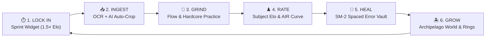

<div align="center">

# ⚡ JEEMAXXING

### *The High-Stakes Cognitive Exam Grind Command Center*

[](#)
[](#)
[](#)
[](#)
[](#)

<br>

<p align="center">
  <b>A competitive, self-coaching examination command deck for JEE aspirants.</b><br>
  Measures problem-solving like a competitive esport, schedules memory recall like Anki,<br>
  polices burnout with biological telemetry — while an island archipelago thrives with your effort.
</p>

---

[**Architecture**](#-architecture-overview) •
[**Core Loop**](#-the-closed-feedback-loop) •
[**Feature Engines**](#-feature-deep-dive) •
[**Memory & Elo Math**](#-mathematical-foundations) •
[**Theme System**](#-cyber-glass-design-system-v4) •
[**Run Locally**](#-running-locally)

---

</div>

> [!NOTE]
> ### 🤡 What is this?
> You are not studying; you are coping. JEEMaxxing is competitive ranked chess for JEE preparation because passively rereading notes was doing nothing for your single-digit mock scores. It treats exam prep like a sweat-drenched esport: your MMR crashes when you guess, Night Guard bullies you to sleep at 23:00 with progressive Elo decay, and a virtual 3D island grows while your social life completely evaporates. Stop whining, queue into Hardcore mode, and fix your skill issue.

<br>

## 🧭 The Closed Feedback Loop

JEEMaxxing eliminates study friction by wrapping prep inside a strict, gamified closed-loop engine:



1. **Lock In** — Fire up deep work sprints with wall-clock precision; banking a true **×1.5 Elo multiplier** while ambient soundscapes play.
2. **Ingest** — Feed problems via Gemini AI dumps, screenshot multi-crop OCR, or JSON bundles with automatic diagram extraction.
3. **Grind** — Execute practice blocks tuned to your current fatigue level across Flow and Hardcore modes.
4. **Rate** — Asymmetric chess-style Elo matchmaking reverse-engineers difficulty and benchmarks your All-India Rank (AIR).
5. **Heal** — Fumbled questions land in the Error Matrix, scheduled by an FSRS/SM-2 power-law decay curve until permanently mastered.
6. **Grow** — Solves water an evolving 3D island world, advancing streak fire and closing daily four-target rings.

---

## 🏛️ Architecture Overview

JEEMaxxing is built completely with **Vanilla ES6 modules**. There are **zero frameworks, zero bundlers, and zero npm build steps**. The browser's native module engine powers the entire application.

```
┌─────────────────────────────────────────────────────────────────────────────┐
│  GLASS SHELL      index.html · dashboard-clean.js · theme.js · fx.js        │
├─────────────────────────────────────────────────────────────────────────────┤
│  CORE ENGINES     app.js                 Orchestrator, Day-Cycle, Ingestion │
│                   matrix.js              Spaced Repetition & Error Vault    │
│                   pomodoro.js            Deep Work & Sprint Timers          │
│                   checkpoint.js          Accountability & Protocol Zero     │
│                   cns-load.js · deload   Fatigue & Recovery Telemetry       │
│                   nightguard.js          Circadian Decay & Sleep Debt       │
│                   grove-islands.js       3D Archipelago Growth Engine       │
├─────────────────────────────────────────────────────────────────────────────┤
│  ANALYTICS        candlestick-engine.js  SVG Cognitive Yield Momentum       │
├─────────────────────────────────────────────────────────────────────────────┤
│  PERSISTENCE      storage.js             IndexedDB (jeemaxxing_db) + Drive  │
│  OFFLINE PWA      sw.js · manifest       Offline Cache (jeemax-v44)         │
│  MATH ENGINE      vendor/katex/          Deterministic Offline TeX          │
└─────────────────────────────────────────────────────────────────────────────┘
```

> [!NOTE]
> **Single Source of Truth**: All app state is owned by `AppState` inside `storage.js`. Changes are coalesced and committed atomically to IndexedDB via `saveAllAsync()`. Cross-module communication is decoupled through audited `window.*` bridges to prevent circular import locks.

---

## ⚡ Feature Deep-Dive

### ⏱️ Deep-Focus Engine (`pomodoro.js` + `focus-sound.js`)
* **Wall-Clock Hardened**: Resilient against tab backgrounding, browser sleep, and clock changes.
* **Ambient Sprint Widget**: Docked persistently in the bottom-right corner across every view. Start sprints, adjust targets, or view live countdowns on demand.
* **×1.5 Deep Work Multiplier**: Active study blocks trigger `body.pomo-active` which awards a genuine **1.5× Elo yield bonus** on all problem solves.
* **Acoustic Soundscapes**: Built-in procedural rain, cafe, fireplace, and binaural white-noise generators that automatically duck during session bells.
* **Quit Friction & Receipts**: Premature termination prompts a forfeit warning; completed blocks generate verified study receipts tracking deep seconds and Elo earned.

---

### ♟️ Dynamic Elo / MMR Matchmaking (`app.js`)
A chess-inspired cognitive matchmaking algorithm that tracks player skill and reverse-engineers question difficulty (`qElo`):
* **Subject-Segregated MMR**: Individual ratings for Physics, Chemistry, and Mathematics (`K=12` for P/C, `K=16` for Maths) alongside an aggregated Global Rating.
* **Competitive Ranks**:
  $$\text{NPC 🧍} \longrightarrow \text{Skill Issue 💀} \longrightarrow \text{Cooking 🍳} \longrightarrow \text{Let Him Cook 👨‍🍳} \longrightarrow \text{Diffed the Exam 💀} \longrightarrow \text{Unhinged Gigachad 🗿}$$
* **Speed Divergence**: Compares your execution time against chapter benchmarks to award `FAST`, `BALANCED`, or `SLOW` rating chips.
* **Tamper-Resistant Accuracy**: First-attempt telemetry is permanently locked (`firstAttemptResult`); re-solves will never artificially inflate rating or metrics.

---

### 🧠 Memory Kernel v2 & Error Matrix (`matrix.js` + `memory.js`)
* **Spaced Repetition Vault**: Automatically captures misses and fumbles tagged by friction reason (`CALC`, `FORMULA`, `CONCEPT`, `APPROACH`).
* **Power-Law Retrievability Curve**: Powered by a 3-variable state kernel (Difficulty $D$, Stability $S$, Retrievability $R$).
* **Coverage-Aware Chapter Health**: A chapter with only 5 of 80 questions reviewed will never claim 100% mastery; readiness requires breadth.
* **Daily Fix Queue**: Auto-curates today's highest-risk decayed memories based on upcoming exam weightage.

---

### 🧬 Recovery & Bio-Feedback Systems
* **CNS Fatigue Meter (`cns-load.js`)**: Real-time telemetry monitoring mental strain based on solve density and time under tension. High load gates hardcore modes.
* **Flow-State Lifeline (`lifeline.js`)**: Activates when $\text{CNS} \ge 0.80$, automatically lowering question difficulty to keep you in flow state (at an honest 0.65× Elo yield).
* **Earned Deload Days (`deload.js`)**: High sustained training unlocks rest days that pause target penalties while fully preserving streaks.
* **Night Guard (`nightguard.js`)**: Progressive late-night Elo decay past 23:00 ($\times 0.80 \to \times 0.55 \to \times 0.20$) to actively punish revenge bedtime procrastination.

---

### 🏝️ Archipelago World & Gamification (`grove-islands.js` + `fx.js`)
* **Growing Living World**: Study seconds and correct answers water a 3D isometric island archipelago rendered via Three.js. Harder questions cultivate rarer flora.
* **Loop-Rail Navigation**: Sidebar rings for Physics, Chemistry, Maths, and Daily Fixes. Closing all four triggers the `LOOP CLOSED` victory state.
* **Sensory FX**: Reactive synth audio, screen ripples, red error flashes, streak-shield glows, and haptic feedback (with full `prefers-reduced-motion` compliance).

---

### 📥 Surgical Ingestion & Diagram Map
* **Gemini AI Extraction**: Paste structured AI dumps with automatic LaTeX delimiter repair and anti-cheat statistical audits.
* **Auto-Crop Coordinate Mapping**: Questions with diagram references (`imageRef` + `cropBox` fractions) can be auto-cropped from full-page test screenshots in a single pass.
* **Multi-Format Grading**: Native evaluation for single MCQ, multi-select, numeric tolerances ($|u - c| < 10^{-6}$), and self-reported proofs.

---

## 📐 Mathematical Foundations

### 1. Memory Kernel v2 (Retrievability & Stability)

$$\mathcal{R}(t, S) = \left( 1 + \frac{19}{81} \cdot \frac{t}{S} \right)^{-0.5}$$

* When recall succeeds (**Pass**):
  $$S' = S \cdot \left[ 1 + G \cdot \left( \frac{11 - D}{10} \right) \cdot S^{-0.15} \cdot \left( e^{0.4(1 - \mathcal{R})} - 1 \right) \right]$$
* When recall fails (**Lapse**):
  $$S' = \max\left( 0.5, \, F \cdot \left( (S + 1)^{0.25} - 1 \right) \cdot \frac{e^{0.3(1 - \mathcal{R})}}{D^{0.2}} \right)$$
* **Chapter Readiness (Coverage-Aware)**:
  $$\text{Health} = \frac{\sum_{i \in \text{All Questions}} \left( \text{qElo}_i \cdot \mathcal{R}_i \right)}{\sum_{i \in \text{All Questions}} \text{qElo}_i} \times 100\%$$

---

### 2. Elo Shift Delta

$$\Delta \text{Elo} = K_{\text{eff}} \cdot \left( S_{\text{actual}} - \mathbb{E}[S] \right) \cdot M_{\text{speed}} \cdot M_{\text{pomo}} \cdot M_{\text{mode}} \cdot M_{\text{night}}$$

Where:
* $M_{\text{pomo}} = 1.5$ during active focus blocks
* $M_{\text{night}} \in \{0.80, 0.55, 0.20\}$ past 23:00
* $M_{\text{speed}}$ rewards answers faster than target time while damping guesses

---

## 🎨 Cyber-Glass Design System v4

The user interface runs on pure tokenized CSS (`:root` variables) featuring responsive glassmorphism and instant live re-skinning:

<div align="center">

| Theme | Palette | Aesthetic Vibe |
| :--- | :--- | :--- |
| **Furnace** | `#f97316` Amber / Flame | High-energy default focus |
| **Synthwave** | `#8b5cf6` Neon Violet | Retro-futuristic cyberpunk night |
| **Glacier** | `#0ea5e9` Arctic Cyan | Clean, cool, low-distraction deep work |
| **Overgrowth** | `#10b981` Emerald Flora | Bioluminescent nature & calm |
| **Blood Moon** | `#ef4444` Crimson / Scarlet | High-intensity hardcore grind |
| **Sakura** | `#f43f5e` Rose Quartz | Soft contrast, aesthetic balance |
| **Stealth** | `#71717a` Monochromatic Gray | Tactical zero-distraction terminal |

**Dual Surface Modes**: `Midnight` (deep-black OLED terminal) & `Dusk` (translucent frosted glass).

</div>

---

## 🗃️ Module Inventory

| Module | Lines | Function |
| :--- | :--- | :--- |
| [`index.html`](file:///c:/Users/Chaksh/Desktop/JEEmaxxing/index.html) | ~1,357 | Single-page shell, modal overlays, scratchpad, HUD |
| [`app.js`](file:///c:/Users/Chaksh/Desktop/JEEmaxxing/app.js) | ~9,500 | Orchestrator, boot sequence, practice engine, Elo rating |
| [`storage.js`](file:///c:/Users/Chaksh/Desktop/JEEmaxxing/storage.js) | ~2,000 | `AppState` single source of truth, IndexedDB, Drive sync |
| [`matrix.js`](file:///c:/Users/Chaksh/Desktop/JEEmaxxing/matrix.js) | ~2,070 | Error vault, spaced repetition scheduler, decay grid |
| [`memory.js`](file:///c:/Users/Chaksh/Desktop/JEEmaxxing/memory.js) | ~300 | Mathematical kernel for FSRS/SM-2 stability & retrievability |
| [`pomodoro.js`](file:///c:/Users/Chaksh/Desktop/JEEmaxxing/pomodoro.js) | ~1,200 | Hardened focus timers, sprint widget, deep work accounting |
| [`checkpoint.js`](file:///c:/Users/Chaksh/Desktop/JEEmaxxing/checkpoint.js) | ~1,400 | Accountability framework, PoW challenges, Protocol Zero |
| [`candlestick-engine.js`](file:///c:/Users/Chaksh/Desktop/JEEmaxxing/candlestick-engine.js) | ~600 | Custom SVG cognitive-yield momentum charts |
| [`cns-load.js`](file:///c:/Users/Chaksh/Desktop/JEEmaxxing/cns-load.js) | ~400 | Real-time Central Nervous System fatigue telemetry |
| [`deload.js`](file:///c:/Users/Chaksh/Desktop/JEEmaxxing/deload.js) | ~350 | Rest period scheduler with streak protection |
| [`nightguard.js`](file:///c:/Users/Chaksh/Desktop/JEEmaxxing/nightguard.js) | ~450 | Late-night circadian yield decay & sleep debt ledger |
| [`grove-islands.js`](file:///c:/Users/Chaksh/Desktop/JEEmaxxing/grove-islands.js) | ~2,570 | Three.js procedurally cultivated island world |
| [`theme.js`](file:///c:/Users/Chaksh/Desktop/JEEmaxxing/theme.js) | ~200 | Dynamic token-switching across 7 themes × 2 appearance modes |
| [`fx.js`](file:///c:/Users/Chaksh/Desktop/JEEmaxxing/fx.js) | ~350 | Web Audio API synth effects, haptics, and particle visuals |

---

## 🚀 Running Locally

Because the project relies on native ES6 browser modules, serve the directory via any local HTTP server:

```bash
# Option 1: Python 3
python3 -m http.server 8000

# Option 2: Node.js (npx)
npx serve .
```

Navigate to `http://localhost:8000` in your browser.

> [!TIP]
> **Zero Installation Required**: No `npm install`, no compilation, no node daemons needed. Open and run instantly.

---

## 📱 PWA & Offline Support

- **Fully Offline**: All scripts, fonts, sounds, and math engines (KaTeX) are cached via Service Worker (`sw.js`, cache version `jeemax-v44`).
- **Network-First HTML**: The shell always checks for updates when online, falling back to cache when offline so updates apply immediately without cache-trapping.
- **Installable**: Supports full PWA installation on Android, iOS (Safari Add to Home Screen), macOS, and Windows.

---

<div align="center">
  <sub>Engineered for relentless focus and elite mastery.</sub><br>
  <b>Lock in. Close the loop. Maximize the rank.</b>
</div>
